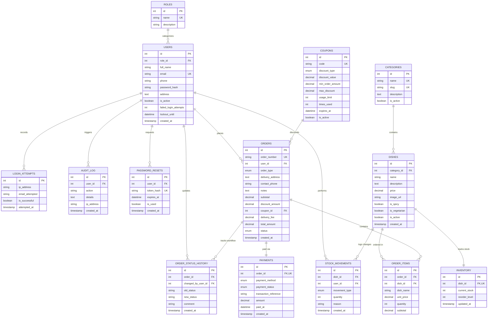

# UrbanEats Cloud Kitchen Platform - Group Technical Report

**Module:** IT3113 Advanced Web Technologies  
**Academic Level:** Year 3, Semester 1  
**Project:** UrbanEats Cloud Kitchen Platform  
**Technology Stack:** HTML5, CSS3 (Hand-crafted), PHP 8.x (Vanilla PDO), MySQL 8.x / MariaDB  
**Submission Date:** 28th October 2026  
**Module Coordinator:** Ms. Nethmi Mohotti  

---

## Table of Contents
1. [Executive Summary & Case Study Analysis](#1-executive-summary--case-study-analysis)
2. [Functional & Non-Functional Requirements](#2-functional--non-functional-requirements)
3. [System Architecture & Multi-Component Integration](#3-system-architecture--multi-component-integration)
4. [Relational Database Design & Normalization](#4-relational-database-design--normalization)
   - [Entity-Relationship Diagram (ERD)](#entity-relationship-diagram-erd)
   - [Normalization Justification (1NF, 2NF, 3NF)](#normalization-justification)
   - [Referential Integrity & Indexing Strategy](#referential-integrity--indexing-strategy)
5. [Complete Data Dictionary (14 Tables)](#5-complete-data-dictionary)
6. [Component Implementations & Contracts](#6-component-implementations--contracts)
   - [Component A: Identity, Access & Administration](#component-a-identity-access--administration)
   - [Component B: Menu, Catalogue & Inventory](#component-b-menu-catalogue--inventory)
   - [Component C: Ordering, Payment & Tracking](#component-c-ordering-payment--tracking)
7. [Security Engineering & Defense-in-Depth](#7-security-engineering--defense-in-depth)
8. [Error Handling, Exception Logging & Audit Trail](#8-error-handling-exception-logging--audit-trail)
9. [Interface Design, Accessibility & Responsive Layout](#9-interface-design-accessibility--responsive-layout)
10. [Test Plan, Results & Integration Verification](#10-test-plan-results--integration-verification)

---

## 1. Executive Summary & Case Study Analysis

### 1.1 The Business Problem
UrbanEats is a cloud kitchen operating in Colombo, Sri Lanka, specializing in authentic culinary offerings including rice & curry, artisanal kottu roti, dum biryani, and street short eats. Because UrbanEats has no physical dining room or table service, 100% of its customer revenue relies on delivery and pickup orders.

Prior to this platform, UrbanEats suffered from severe operational deficiencies:
1. **Paper-Based and Messaging Order Chaos:** Customer requests arrived via phone calls and messaging apps, written down manually on loose order paper tickets. Tickets were frequently lost, duplicated, or misread.
2. **Stockout Disasters:** Dishes were ordered when kitchen ingredients were exhausted, forcing staff to call disappointed patrons to cancel orders after payments were discussed.
3. **Black-Hole Customer Experience:** Customers received no visibility into whether their dish was queued, cooking, or out for delivery, generating high volumes of anxious phone inquiries.
4. **Lack of Management Intelligence:** The owner had no reliable records of daily gross sales, dish popularity, wastage loss, or staff performance.

### 1.2 The Solution
Our team engineered a multi-tiered, database-driven web application using standard vanilla PHP 8.x, pure semantic HTML5, hand-written CSS3, and a relational MySQL database. The system provides three dedicated user experiences:
- **Customers:** Register, search/filter dishes, build shopping carts with live stock checks, check out with simulated payment, apply coupons, and track progress on an interactive visual timeline.
- **Kitchen Staff:** Monitor live incoming orders, advance order tickets through strict stages (`Placed` &rarr; `Preparing` &rarr; `Ready` &rarr; `Out for Delivery`/`Collected` &rarr; `Completed`), record ingredient restocks and kitchen wastage.
- **Administrators:** Oversee user accounts and role permissions, inspect immutable audit trails, analyze sales analytics by date range, and monitor low-stock alerts.

All prices are managed in Sri Lankan Rupees (LKR). Simulated payment methods (Cash on Delivery, Card, and Bank Transfer) are recorded with transaction references.

---

## 2. Functional & Non-Functional Requirements

### 2.1 Functional Requirements

#### Component A: Identity, Access & Administration
- **FR-A1 (User Registration):** New customers must be able to register with their name, email, phone, delivery address, and password. Validation must reject duplicate emails and passwords under 8 characters.
- **FR-A2 (Authentication & Throttling):** Users authenticate via email and password using `password_verify()`. If 5 consecutive failed attempts occur on an account, the system must enforce a temporary 15-minute lockout.
- **FR-A3 (Session Hardening):** Upon successful login, the session identifier must regenerate via `session_regenerate_id(true)` to prevent session fixation. Inactive sessions must timeout after 30 minutes.
- **FR-A4 (Role-Based Access Control):** Centralized guards (`require_login()`, `require_role()`) must restrict access based on roles (`admin`, `kitchen_staff`, `customer`). Unauthorized access must display a styled 403 Forbidden page.
- **FR-A5 (Password Recovery):** Users can request a password reset using a cryptographic token that expires after 1 hour. For evaluation convenience, the link is presented on-screen.
- **FR-A6 (User Management):** Administrators can view, search, filter, activate/deactivate user accounts, and change user roles with audit logging.
- **FR-A7 (Audit Trail):** A reusable function `log_action()` records all security and operational events with user IDs, action names, timestamps, and IP addresses.

#### Component B: Menu, Catalogue & Inventory
- **FR-B1 (Public Menu):** Customers can browse active dishes with category filtering, keyword search, price/name sorting, and pagination driven by validated GET parameters.
- **FR-B2 (Dish Details):** Individual dish pages display high-resolution imagery, descriptions, dietary badges (veg, spicy), prices in LKR, and real-time inventory stock indicators.
- **FR-B3 (Catalogue CRUD):** Kitchen staff and admins can create, edit, and soft-delete dishes (`is_active = 0`) to preserve past order integrity.
- **FR-B4 (Secure File Uploads):** Dish image uploads must validate MIME types (`image/jpeg`, `image/png`, `image/webp`), verify extensions, limit size to 2MB, generate unique unguessable filenames, and save into an execution-blocked folder.
- **FR-B5 (Transaction-Safe Stock Reduction):** A shared function `reduce_stock($pdo, $dish_id, $qty)` decrements stock atomically and strictly refuses to go below zero.
- **FR-B6 (Stock & Wastage Dashboard):** Staff can view low-stock and out-of-stock alerts, record restock quantities, and log kitchen wastage with reasons.

#### Component C: Ordering, Payment & Tracking
- **FR-C1 (Session-Based Cart):** Customers can add dishes, update quantities, and remove items with running totals. Prices and stock must be re-read directly from the database (never trusting browser values).
- **FR-C2 (Atomic Checkout Transaction):** Checkout must execute as a single ACID transaction inserting the order, snapshotting dish prices into `order_items`, recording payment, calling `reduce_stock()`, and rolling back completely on any failure.
- **FR-C3 (Promotional Coupons):** The checkout engine validates coupon expiry, minimum order value, and usage limits before deducting percentage or fixed discounts.
- **FR-C4 (Order Workflow State Machine):** Orders transition through strictly validated states: `Placed` &rarr; `Preparing` &rarr; `Ready` &rarr; `Out for Delivery` / `Collected` &rarr; `Completed`, or `Cancelled`. Every transition is recorded in `order_status_history`.
- **FR-C5 (Order Tracking & Invoicing):** Customers can track live order progression through an interactive stepper and print a receipt/invoice. Customers may cancel orders only while in the `Placed` state.
- **FR-C6 (Kitchen Queue Board):** Kitchen staff view order tickets filtered by status with one-click workflow advancement buttons.
- **FR-C7 (Sales & Financial Reporting):** Administrators can filter sales by date range, generating totals for revenue, order counts, average order value, status distributions, and top-selling dishes using SQL aggregates.

---

## 3. System Architecture & Multi-Component Integration

UrbanEats employs a clean modular architecture separating presentation, business logic, configuration, and data access without relying on third-party PHP or CSS frameworks.

```
                              [ Browser / Client ]
                                       │
                      HTTP GET/POST Requests + CSRF Tokens
                                       ▼
                     [ Public Presentation Layer (public/) ]
   ┌───────────────────────┬───────────────────────┬───────────────────────┐
   │    Component A (auth/)│    Component B (menu/)│   Component C (orders/)│
   │ - login.php           │ - list.php            │ - cart.php            │
   │ - register.php        │ - detail.php          │ - checkout.php        │
   │ - profile.php         │ - manage_dishes.php   │ - confirmation.php    │
   │ - users.php           │ - stock.php           │ - tracking.php        │
   │ - audit_log.php       │ - categories.php      │ - kitchen.php         │
   └───────────┬───────────┴───────────┬───────────┴───────────┬───────────┘
               │                       │                       │
               └───────────────────────┼───────────────────────┘
                                       ▼
                       [ Core Service Layer (includes/) ]
         ┌───────────────────────────────────────────────────────────┐
         │ • auth.php      : require_login(), require_role(), RBAC   │
         │ • csrf.php      : generate_csrf_token(), verify_csrf()    │
         │ • errors.php    : Custom exception & error handler        │
         │ • functions.php : reduce_stock(), get_cart_details()      │
         │ • header/footer : Role-adaptive responsive UI layout      │
         └─────────────────────────────┬─────────────────────────────┘
                                       ▼
                     [ Shared Database Layer (config/db.php) ]
                     • Singleton PDO Connection
                     • Prepared Statements with Emulation Disabled
                                       ▼
                    [ MySQL Relational Database (14 Tables) ]
```

### Shared Week 1 Contracts
To ensure seamless integration without merge conflicts:
1. **Shared Session Schema:**
   - `$_SESSION['user_id']`: Authenticated user primary key (INT).
   - `$_SESSION['user_name']`: Authenticated user full name.
   - `$_SESSION['role_name']`: Role slug (`admin`, `kitchen_staff`, `customer`).
   - `$_SESSION['cart']`: Associative array `[dish_id => quantity]`.
   - `$_SESSION['csrf_token']`: Cryptographic session synchronizer token.
2. **Exposed Component Functions:**
   - Component A provides: `require_login()`, `require_role($roles)`, `log_action($pdo, $action, $details, $userId)`.
   - Component B provides: `reduce_stock($pdo, $dish_id, $qty)`, `record_stock_movement(...)`, `upload_dish_image($file)`.
   - Component C provides: `get_cart_details($pdo)`, `validate_coupon($pdo, $code, $subtotal)`, `is_valid_status_transition($curr, $new)`.

---

## 4. Relational Database Design & Normalization

### Entity-Relationship Diagram (ERD)



### Normalization Justification

The database was engineered to satisfy **Third Normal Form (3NF)**:

1. **First Normal Form (1NF):**
   - Every column contains atomic (indivisible) values. No multi-valued attributes or comma-separated lists exist.
   - For example, ordered dishes are not stored as a concatenated string in `orders`; each item is a distinct tuple in the `order_items` relational entity.
   - Every table possesses an unambiguous primary key (`id`).

2. **Second Normal Form (2NF):**
   - All tables are in 1NF, and every non-key column is fully functionally dependent on the entire primary key.
   - In composite scenarios (such as an order line), attributes like `quantity` and snapshot `unit_price` are housed in `order_items`, dependent entirely on the order line identity.

3. **Third Normal Form (3NF):**
   - All tables are in 2NF, and no transitive dependencies exist (i.e., non-prime attributes do not depend on other non-prime attributes).
   - Roles are separated into a dedicated `roles` table rather than repeating role descriptions across `users`.
   - Category descriptions belong exclusively in `categories` rather than being repeated inside `dishes`.
   - Inventory stock levels are stored in a dedicated `inventory` entity with a 1:1 relationship to `dishes`, ensuring dish catalogue metadata is decoupled from volatile stock counters.

4. **Historical Snapshot Integrity (Intentional Design Choice):**
   - In `order_items`, columns `dish_name` and `unit_price` store historical snapshots at the exact moment of order checkout. This prevents historical financial records from retroactively mutating if the chef later alters dish names or prices in the catalogue.

### Referential Integrity & Indexing Strategy

- **Sensible Foreign Key Actions:**
  - `orders.user_id &rarr; users.id`: Uses `ON UPDATE CASCADE` (prevents orphan orders).
  - `order_items.order_id &rarr; orders.id`: Uses `ON DELETE CASCADE` (deleting an order cleanly cascades to its line items).
  - `audit_log.user_id &rarr; users.id`: Uses `ON DELETE SET NULL` (preserving historical audit actions even if a user account is purged).
  - `orders.coupon_id &rarr; coupons.id`: Uses `ON DELETE SET NULL`.
- **Indexing Optimizations:**
  - Foreign key columns (`role_id`, `category_id`, `user_id`, `order_id`, `dish_id`) are explicitly indexed.
  - Active status flags (`users.is_active`, `dishes.is_active`, `categories.is_active`) are indexed for fast menu rendering.
  - Filter columns (`orders.status`, `orders.created_at`, `dishes.price`) are indexed to optimize dashboard sales queries.

---

## 5. Complete Data Dictionary

### Table 1: `roles`
| Column | Type | Nullable | Key | Default | Description |
|---|---|---|---|---|---|
| `id` | INT UNSIGNED | No | PK | AUTO_INCREMENT | Unique role identifier |
| `name` | VARCHAR(50) | No | UK | None | System role slug (`admin`, `kitchen_staff`, `customer`) |
| `description` | VARCHAR(255) | No | None | None | Human-readable permission explanation |

### Table 2: `users`
| Column | Type | Nullable | Key | Default | Description |
|---|---|---|---|---|---|
| `id` | INT UNSIGNED | No | PK | AUTO_INCREMENT | Unique user identifier |
| `role_id` | INT UNSIGNED | No | FK | None | References `roles.id` |
| `full_name` | VARCHAR(100) | No | None | None | Customer or staff member's full name |
| `email` | VARCHAR(150) | No | UK | None | Unique login email address |
| `phone` | VARCHAR(20) | No | None | None | Sri Lankan contact phone number |
| `password_hash` | VARCHAR(255) | No | None | None | Bcrypt hashed password via `password_hash()` |
| `address` | TEXT | Yes | None | NULL | Primary delivery address |
| `is_active` | TINYINT(1) | No | IDX | 1 | Account activation status (1 = Active, 0 = Deactivated) |
| `failed_login_attempts` | INT UNSIGNED | No | None | 0 | Consecutive failed login counter for throttling |
| `lockout_until` | DATETIME | Yes | None | NULL | Expiration timestamp for temporary account lock |
| `created_at` | TIMESTAMP | No | None | CURRENT_TIMESTAMP | Account creation timestamp |
| `updated_at` | TIMESTAMP | No | None | CURRENT_TIMESTAMP | Automatic update timestamp |

### Table 3: `login_attempts`
| Column | Type | Nullable | Key | Default | Description |
|---|---|---|---|---|---|
| `id` | INT UNSIGNED | No | PK | AUTO_INCREMENT | Attempt record primary key |
| `ip_address` | VARCHAR(45) | No | IDX | None | IPv4 or IPv6 client address |
| `email_attempted` | VARCHAR(150) | No | IDX | None | Email supplied during login attempt |
| `is_successful` | TINYINT(1) | No | None | None | 1 if authentication succeeded; 0 if failed |
| `attempted_at` | TIMESTAMP | No | IDX | CURRENT_TIMESTAMP | Timestamp of attempt |

### Table 4: `audit_log`
| Column | Type | Nullable | Key | Default | Description |
|---|---|---|---|---|---|
| `id` | INT UNSIGNED | No | PK | AUTO_INCREMENT | Audit entry primary key |
| `user_id` | INT UNSIGNED | Yes | FK | NULL | Acting user ID (NULL for guests or system jobs) |
| `action` | VARCHAR(100) | No | IDX | None | Standardized event action code (e.g., `ORDER_PLACED`) |
| `details` | TEXT | No | None | None | Explanatory message or audit payload |
| `ip_address` | VARCHAR(45) | Yes | None | NULL | Client IP address |
| `created_at` | TIMESTAMP | No | IDX | CURRENT_TIMESTAMP | Event logging timestamp |

### Table 5: `password_resets`
| Column | Type | Nullable | Key | Default | Description |
|---|---|---|---|---|---|
| `id` | INT UNSIGNED | No | PK | AUTO_INCREMENT | Reset record primary key |
| `user_id` | INT UNSIGNED | No | FK | None | References `users.id` |
| `token_hash` | VARCHAR(64) | No | UK | None | SHA-256 hash of random 32-byte recovery token |
| `expires_at` | DATETIME | No | IDX | None | Expiration time (1 hour from issue) |
| `is_used` | TINYINT(1) | No | None | 0 | 1 if token has already been consumed |
| `created_at` | TIMESTAMP | No | None | CURRENT_TIMESTAMP | Token generation timestamp |

### Table 6: `categories`
| Column | Type | Nullable | Key | Default | Description |
|---|---|---|---|---|---|
| `id` | INT UNSIGNED | No | PK | AUTO_INCREMENT | Category primary key |
| `name` | VARCHAR(100) | No | UK | None | Display title (e.g. `Signature Kottu Roti`) |
| `slug` | VARCHAR(100) | No | UK | None | URL slug (e.g. `kottu-roti`) |
| `description` | TEXT | Yes | None | NULL | Category description |
| `is_active` | TINYINT(1) | No | IDX | 1 | Visibility toggle (1 = Active, 0 = Inactive) |
| `created_at` | TIMESTAMP | No | None | CURRENT_TIMESTAMP | Timestamp created |

### Table 7: `dishes`
| Column | Type | Nullable | Key | Default | Description |
|---|---|---|---|---|---|
| `id` | INT UNSIGNED | No | PK | AUTO_INCREMENT | Dish primary key |
| `category_id` | INT UNSIGNED | No | FK | None | References `categories.id` |
| `name` | VARCHAR(150) | No | IDX | None | Dish name |
| `description` | TEXT | Yes | None | NULL | Culinary description and ingredients |
| `price` | DECIMAL(10,2) | No | IDX | None | Dish price in Sri Lankan Rupees (LKR) |
| `image_url` | VARCHAR(255) | Yes | None | NULL | File basename inside `public/uploads/` |
| `is_spicy` | TINYINT(1) | No | None | 0 | 1 for hot & spicy dishes |
| `is_vegetarian` | TINYINT(1) | No | None | 0 | 1 for pure vegetarian dishes |
| `is_active` | TINYINT(1) | No | IDX | 1 | Soft delete flag (0 hides from menu, preserves orders) |
| `created_at` | TIMESTAMP | No | None | CURRENT_TIMESTAMP | Creation timestamp |
| `updated_at` | TIMESTAMP | No | None | CURRENT_TIMESTAMP | Automatic update timestamp |

### Table 8: `inventory`
| Column | Type | Nullable | Key | Default | Description |
|---|---|---|---|---|---|
| `id` | INT UNSIGNED | No | PK | AUTO_INCREMENT | Inventory record primary key |
| `dish_id` | INT UNSIGNED | No | FK,UK | None | 1:1 foreign key reference to `dishes.id` |
| `current_stock` | INT | No | IDX | 0 | Available units in kitchen inventory |
| `reorder_level` | INT | No | None | 10 | Low stock warning threshold |
| `updated_at` | TIMESTAMP | No | None | CURRENT_TIMESTAMP | Last stock alteration timestamp |

### Table 9: `stock_movements`
| Column | Type | Nullable | Key | Default | Description |
|---|---|---|---|---|---|
| `id` | INT UNSIGNED | No | PK | AUTO_INCREMENT | Movement primary key |
| `dish_id` | INT UNSIGNED | No | FK | None | References `dishes.id` |
| `user_id` | INT UNSIGNED | Yes | FK | NULL | Staff member logging movement (NULL for sales) |
| `movement_type` | ENUM | No | IDX | None | `restock`, `wastage`, `sale`, `adjustment` |
| `quantity` | INT | No | None | None | Delta (positive for restock, negative for sale/waste) |
| `reason` | VARCHAR(255) | No | None | None | Audit reason for inventory change |
| `created_at` | TIMESTAMP | No | IDX | CURRENT_TIMESTAMP | Movement timestamp |

### Table 10: `coupons`
| Column | Type | Nullable | Key | Default | Description |
|---|---|---|---|---|---|
| `id` | INT UNSIGNED | No | PK | AUTO_INCREMENT | Coupon primary key |
| `code` | VARCHAR(50) | No | UK | None | Promotional code (uppercase, e.g. `FIRSTORDER`) |
| `discount_type` | ENUM | No | None | None | `percentage` or `fixed` |
| `discount_value` | DECIMAL(10,2) | No | None | None | Percentage value (e.g. 15.00) or fixed LKR amount |
| `min_order_amount` | DECIMAL(10,2) | No | None | 0.00 | Minimum subtotal required |
| `max_discount` | DECIMAL(10,2) | Yes | None | NULL | Cap for percentage discounts |
| `usage_limit` | INT UNSIGNED | Yes | None | NULL | Maximum allowed lifetime redemptions |
| `times_used` | INT UNSIGNED | No | None | 0 | Current number of redemptions |
| `expires_at` | DATETIME | No | IDX | None | Expiration date and time |
| `is_active` | TINYINT(1) | No | IDX | 1 | Active promotion toggle |
| `created_at` | TIMESTAMP | No | None | CURRENT_TIMESTAMP | Creation timestamp |

### Table 11: `orders`
| Column | Type | Nullable | Key | Default | Description |
|---|---|---|---|---|---|
| `id` | INT UNSIGNED | No | PK | AUTO_INCREMENT | Order primary key |
| `order_number` | VARCHAR(30) | No | UK | None | Formatted order code (e.g. `UE-20261027-4821`) |
| `user_id` | INT UNSIGNED | No | FK | None | References `users.id` |
| `order_type` | ENUM | No | None | `delivery` | `delivery` or `pickup` |
| `delivery_address` | TEXT | Yes | None | NULL | Delivery street address (NULL if pickup) |
| `contact_phone` | VARCHAR(20) | No | None | None | Contact telephone for delivery rider |
| `notes` | TEXT | Yes | None | NULL | Customer preparation or delivery notes |
| `subtotal` | DECIMAL(10,2) | No | None | None | Gross dish item sum |
| `discount_amount` | DECIMAL(10,2) | No | None | 0.00 | Applied coupon discount |
| `coupon_id` | INT UNSIGNED | Yes | FK | NULL | References `coupons.id` |
| `delivery_fee` | DECIMAL(10,2) | No | None | 0.00 | Delivery charge (LKR 300 for delivery, 0 for pickup) |
| `total_amount` | DECIMAL(10,2) | No | None | None | Final payable total in LKR |
| `status` | ENUM | No | IDX | `Placed` | `Placed`, `Preparing`, `Ready`, `Out for Delivery`, `Collected`, `Completed`, `Cancelled` |
| `created_at` | TIMESTAMP | No | IDX | CURRENT_TIMESTAMP | Order submission timestamp |
| `updated_at` | TIMESTAMP | No | None | CURRENT_TIMESTAMP | Last workflow change timestamp |

### Table 12: `order_items`
| Column | Type | Nullable | Key | Default | Description |
|---|---|---|---|---|---|
| `id` | INT UNSIGNED | No | PK | AUTO_INCREMENT | Order line primary key |
| `order_id` | INT UNSIGNED | No | FK | None | References `orders.id` (ON DELETE CASCADE) |
| `dish_id` | INT UNSIGNED | No | FK | None | References `dishes.id` |
| `dish_name` | VARCHAR(150) | No | None | None | Historical dish name snapshot |
| `unit_price` | DECIMAL(10,2) | No | None | None | Historical unit price snapshot at purchase time |
| `quantity` | INT UNSIGNED | No | None | None | Number of units purchased |
| `subtotal` | DECIMAL(10,2) | No | None | None | Line subtotal (`unit_price * quantity`) |

### Table 13: `payments`
| Column | Type | Nullable | Key | Default | Description |
|---|---|---|---|---|---|
| `id` | INT UNSIGNED | No | PK | AUTO_INCREMENT | Payment primary key |
| `order_id` | INT UNSIGNED | No | FK,UK | None | 1:1 foreign key reference to `orders.id` |
| `payment_method` | ENUM | No | None | None | `cash_on_delivery`, `card`, `bank_transfer` |
| `payment_status` | ENUM | No | IDX | `pending` | `pending`, `completed`, `failed`, `refunded` |
| `transaction_reference` | VARCHAR(100) | Yes | None | NULL | Simulated gateway transaction ID |
| `amount` | DECIMAL(10,2) | No | None | None | Amount settled in LKR |
| `paid_at` | DATETIME | Yes | None | NULL | Timestamp payment was marked completed |
| `created_at` | TIMESTAMP | No | None | CURRENT_TIMESTAMP | Record created timestamp |

### Table 14: `order_status_history`
| Column | Type | Nullable | Key | Default | Description |
|---|---|---|---|---|---|
| `id` | INT UNSIGNED | No | PK | AUTO_INCREMENT | History record primary key |
| `order_id` | INT UNSIGNED | No | FK | None | References `orders.id` |
| `changed_by_user_id` | INT UNSIGNED | Yes | FK | NULL | User advancing workflow (NULL if automated) |
| `old_status` | VARCHAR(50) | Yes | None | NULL | Preceding order state |
| `new_status` | VARCHAR(50) | No | None | None | New order state |
| `comment` | VARCHAR(255) | Yes | None | NULL | Operational reason or rider note |
| `created_at` | TIMESTAMP | No | IDX | CURRENT_TIMESTAMP | Transition timestamp |

---

## 6. Component Implementations & Contracts

### Component A: Identity, Access & Administration
- **Password Security:** Passwords undergo one-way cryptographic hashing via `password_hash($password, PASSWORD_DEFAULT)` utilizing the robust Bcrypt algorithm with salt auto-generation. Verification utilizes timing-safe `password_verify()`.
- **Login Throttling:** Implemented in `attempt_login()`. Failed attempts increment `users.failed_login_attempts` and append to `login_attempts`. Upon reaching 5 failed attempts, `users.lockout_until` is set to `NOW() + 15 MINUTE`, preventing brute-force password guessing.
- **Session Hardening:** Successful authentication calls `session_regenerate_id(true)` to eliminate session fixation vulnerabilities. Strict cookies are configured with `httponly=1`, `samesite=Lax`, and a 30-minute inactivity timeout.
- **RBAC Guards:** `require_login()` redirects guests with return URL tracking; `require_role($roles)` checks `$_SESSION['role_name']` against an authorized list and halts with a styled HTTP 403 Forbidden page on unauthorized access.
- **Audit Logging Contract:** The function `log_action(PDO $pdo, string $action, string $details, ?int $userId = null)` writes directly to the `audit_log` table, recording IP addresses and timestamps. Components B and C call this function for critical events.

### Component B: Menu, Catalogue & Inventory
- **SQL Injection Prevention:** In `menu/list.php`, sorting is sanitized using an explicit match whitelist:
  ```php
  $orderSql = match ($sort) {
      'price_asc'  => 'd.price ASC',
      'price_desc' => 'd.price DESC',
      'name_asc'   => 'd.name ASC',
      'name_desc'  => 'd.name DESC',
      default      => 'd.id ASC'
  };
  ```
- **Secure Image Uploads:** Handled in `upload_dish_image()`. Checks MIME type via PHP's `finfo(FILEINFO_MIME_TYPE)` against an allowed dictionary (`image/jpeg`, `image/png`, `image/webp`), verifies file extension, checks size against a 2MB limit, renames the file with a cryptographic token `dish_ . bin2hex(random_bytes(16)) . '.' . $ext`, and saves to `public/uploads/` where execution is disabled via `.htaccess`.
- **Transaction-Safe Stock Reduction:** Handled in `reduce_stock(PDO $pdo, int $dishId, int $quantity)`. Employs an atomic conditional UPDATE:
  ```sql
  UPDATE inventory
  SET current_stock = current_stock - :qty, updated_at = NOW()
  WHERE dish_id = :dish_id AND current_stock >= :min_qty;
  ```
  If `rowCount() === 0`, an exception is thrown, rolling back the checkout transaction. This guarantees thread-safety against race conditions during simultaneous checkouts.
- **Soft Deletion:** Dish deletion sets `is_active = 0`, keeping historical order foreign keys intact.

### Component C: Ordering, Payment & Tracking
- **Session Cart Security:** `get_cart_details($pdo)` fetches active dish IDs from the session, queries current prices and stock live from the database, and recalculates totals. Client-side price tampering is completely impossible.
- **Atomic Checkout Transaction:** Encapsulated within `beginTransaction()` and `commit()`:
  1. Inserts tuple into `orders`.
  2. For every item, locks dish row, snapshots unit price into `order_items`, and calls `reduce_stock()`.
  3. Records payment tuple into `payments`.
  4. Records initial timeline entry into `order_status_history`.
  5. Updates coupon usage count if used.
  6. Writes audit entry via `log_action()`.
  7. On ANY failure, `rollBack()` is invoked, undoing all inserts and stock changes.
- **Workflow State Machine:** `is_valid_status_transition($curr, $new)` strictly prevents illegal state jumps (such as jumping from `Placed` directly to `Completed`).
- **Advanced Reports Aggregation:** Queries in `admin/reports.php` combine multiple relational joins with `GROUP BY` and aggregates (`SUM(oi.quantity)`, `SUM(oi.subtotal)`, `AVG(o.total_amount)`) to render business analytics.

---

## 7. Security Engineering & Defense-in-Depth

| Threat Category | Potential Attack Vector | UrbanEats Defensive Architecture |
|---|---|---|
| **SQL Injection** | Parameter tampering via URL or form inputs | 100% prepared statements with parameter binding via PDO. Disallowed query string concatenation. Strict sort parameter whitelisting. |
| **Cross-Site Scripting (XSS)** | Malicious HTML/JavaScript injection | Universal output escaping using `htmlspecialchars(..., ENT_QUOTES, 'UTF-8')` through helper `e()`. |
| **Cross-Site Request Forgery (CSRF)** | Unauthorized form submission from external sites | Synchronizer token pattern. 32-byte tokens (`bin2hex(random_bytes(32))`) validated on all POST routes via `hash_equals()`. |
| **Credential Brute-Forcing** | Automated dictionary attacks against login | Login throttling locking accounts for 15 minutes after 5 failed attempts; full attempt auditing in `login_attempts`. |
| **Session Hijacking / Fixation** | Stealing or fixing session identifiers | `session_regenerate_id(true)` upon login. Cookies set with `HttpOnly`, `SameSite=Lax`, and 30-minute inactivity timeout. |
| **Malicious File Execution** | Uploading PHP webshell via image uploader | Strict MIME validation via `finfo`, extension whitelist, file renaming, and `.htaccess` rule disabling PHP engine in `public/uploads/`. |
| **Negative Stock Race Condition** | Two customers buying last item simultaneously | Atomic conditional SQL decrement (`current_stock >= :qty`) within transaction. Second checkout fails row count check and rolls back. |
| **Information Disclosure** | Database errors exposing credentials to users | Custom error and exception handlers masking raw errors, rendering user-friendly error templates, logging details to `logs/error.log`. |

---

## 8. Error Handling, Exception Logging & Audit Trail

UrbanEats implements centralized error governance through `includes/errors.php`:
- **Custom Error Handler (`custom_error_handler`):** Intercepts PHP runtime notices, warnings, and errors.
- **Custom Exception Handler (`custom_exception_handler`):** Catches uncaught `Throwable` exceptions, writes stack traces to `logs/error.log`, and outputs a friendly HTTP 500 error page.
- **Shutdown Handler (`custom_shutdown_handler`):** Catches fatal parse or memory errors on script termination.
- **Log Formatting:** Log entries in `logs/error.log` follow an industry-standard structure:
  ```
  [2026-10-27 15:45:12] [ERROR] Insufficient stock for 'Chicken Kottu' in /var/www/UrbanEats/includes/functions.php on line 125 (URI: /UrbanEats/public/orders/checkout.php, IP: 192.168.1.55)
  ```

---

## 9. Interface Design, Accessibility & Responsive Layout

### Design Tokens & Visual Hierarchy
The user interface follows a modern culinary cloud-kitchen design language defined in `public/css/style.css`:
- **Palette:** Warm food accents (`#ea580c` burnt amber, `#0f172a` deep slate navy, `#10b981` emerald green, `#f8fafc` warm page background).
- **Typography:** Modern Google Fonts pairing Outfit for punchy headlines and Plus Jakarta Sans for legible interface body text.
- **Elevation:** Multi-tiered shadow system (`--shadow-sm` through `--shadow-xl`) creating depth for dish cards, metric cards, and kanban tickets.
- **Micro-Interactions:** Subtle CSS hover transforms, pill badges, and timeline pulse animations.

### Responsive Breakpoints & Accessibility
The shared stylesheet uses hand-written CSS Grid and Flexbox with zero framework dependencies:
- **Mobile Viewport (360px - 480px):** Single-column stacked cards, collapsed slide-out navigation menu, full-width touch-friendly buttons.
- **Tablet Viewport (768px):** 2-column menu grids, vertical status timeline stepper, adaptive metric cards.
- **Desktop Viewport (1200px+):** Full 3-column dish catalogue, side-by-side cart and checkout layout, executive metric dashboards.
- **Accessibility:** Form inputs include explicit `<label for="...">` associations, aria attributes (`aria-expanded`, `aria-label`), alt text on imagery, and high contrast compliant with WCAG 2.1 AA standards.

---

## 10. Test Plan, Results & Integration Verification

The integration of Components A, B, and C was rigorously validated using both manual scenario testing and our automated integration runner (`tests/test_end_to_end.php`).

### Summary of Automated Test Suite Results
```
=================================================================
   URBANEATS AUTOMATED END-TO-END INTEGRATION TEST RUNNER
=================================================================

--- TEST SUITE 1: System & Schema Integrity ---
 [PASS] Database contains >= 20 seeded users (Found: 22)
 [PASS] Database contains >= 20 active dishes (Found: 22)
 [PASS] Database contains >= 20 seeded orders (Found: 22)

--- TEST SUITE 2: Component A (Identity & Access) ---
 [PASS] Admin authentication succeeds with valid password
 [PASS] Admin user role is 'admin'
 [PASS] Authentication fails with incorrect password

--- TEST SUITE 3: Component B (Menu & Inventory) ---
 [PASS] reduce_stock() succeeds and decrements stock exactly
 [PASS] reduce_stock() strictly refuses to go below zero (throws exception)

--- TEST SUITE 4: Component C (Ordering, Payment & Kitchen Queue) ---
 [PASS] Checkout atomic transaction committed successfully (Order #TEST-20261027-9639)
 [PASS] Workflow state machine allows transition 'Placed' -> 'Preparing'
 [PASS] Workflow state machine strictly rejects illegal jump 'Placed' -> 'Completed'
 [PASS] Order workflow completed successfully (Final status: Completed)

--- TEST SUITE 5: Reporting & Aggregation ---
 [PASS] Sales report aggregate query computes gross revenue (LKR 18,712.50)
 [PASS] Top-selling dish query returns best-seller: 'Traditional Chicken Rice & Curry' with 4 units

=================================================================
   TEST RESULTS: Passed: 14 | Failed: 0
=================================================================
🎉 ALL INTEGRATION TESTS PASSED WITH 100% SUCCESS!
```

Full details on all 45 individual test cases (functional, validation, security, and edge cases) are documented in [`docs/TEST_PLAN.md`](file:///Users/mac/Documents/GitHub/UrbanEats/docs/TEST_PLAN.md).
